# deskwalk

[](https://github.com/DmE89/deskwalk/actions/workflows/tests.yml)
[](LICENSE)


Control your Kingsmith WalkingPad A1 Pro from any browser. Keep the belt running when you step off,
track your sessions and calibrate your stride. No app, no account, no cloud.

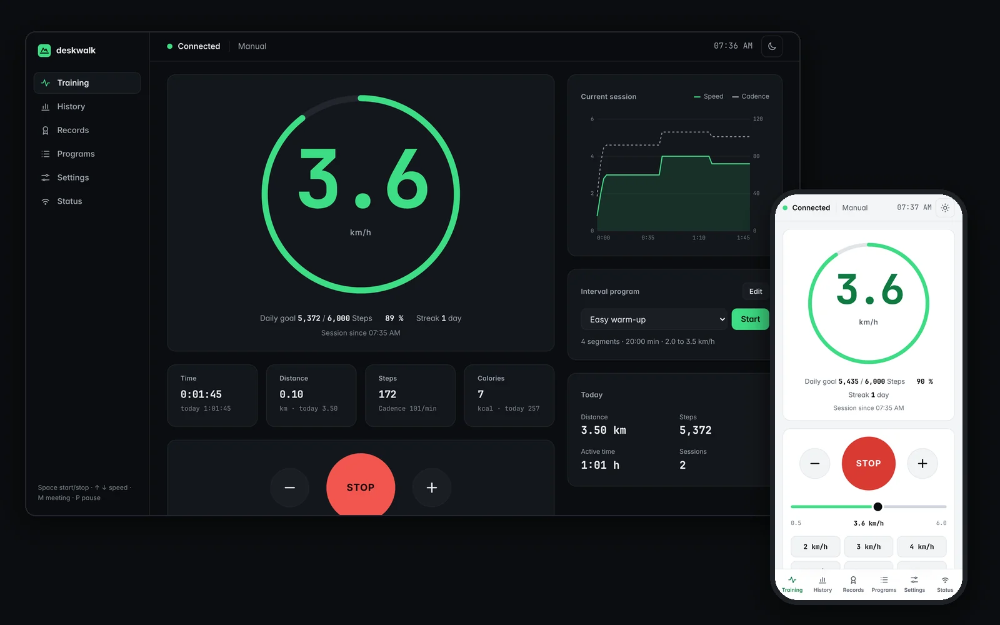

A small Python server talks to the belt via Bluetooth, the browser shows the UI. It works on a laptop
and on a phone in the same Wi-Fi, in Firefox, Safari, Chrome and Brave.

> Not an official project. No affiliation with Kingsmith or WalkingPad.

## Features

**Walking**
- Live speed, time, distance, steps, calories and cadence
- Start, stop, plus and minus, speed slider, quick speeds
- Meeting button: slow down for a call, press again for the previous speed
- Pause button: stop and continue at the same speed
- Interval programs with your own segments
- Keyboard control for walking at the desk

**Tracking**
- Sessions with a live chart, history of 30 days, a year heat map and records
- Daily goal in steps or kilometres, streaks
- Own step count from your calibrated stride length, the belt counter stays visible
- Import of walks stored in the belt, for walks with the remote control only
- CSV and TCX export (TCX works with Strava and Garmin Connect)

**Belt**
- Belt settings read from the belt: smart start/stop, sensitivity, child lock, start and max speed,
  units and values on the belt display
- Novice guide to lift the 3 km/h limit of new belts
- Model, firmware and protocol version, error codes with their meaning
- Oiling reminder after kilometres or days, belt centering run with step by step help

**App**
- English or German, metric or imperial, system, dark or light theme
- Installable on the phone home screen
- Movement reminder after a time without walking
- No JavaScript libraries, no build step, no external requests. The only dependency is `bleak`.

## Screenshots

| | |
|---|---|
| 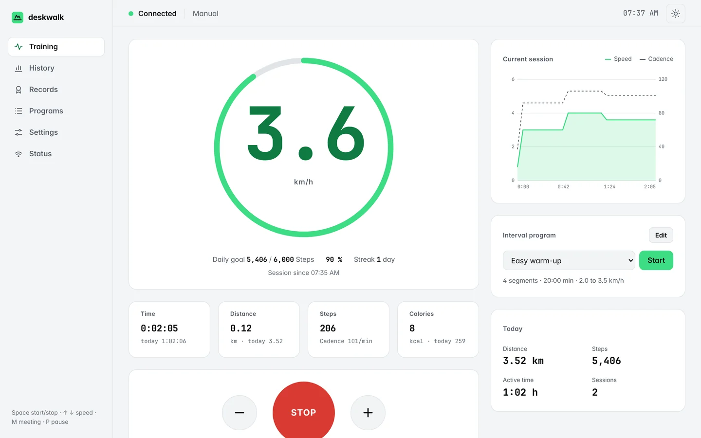 | 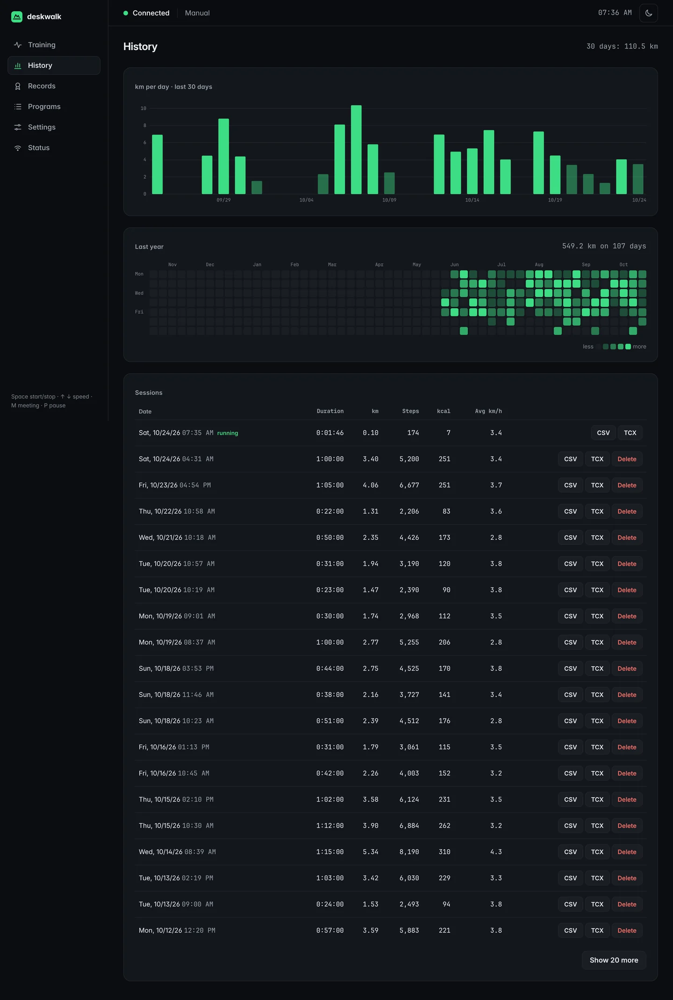 |
| Training, light theme | History with heat map |
| 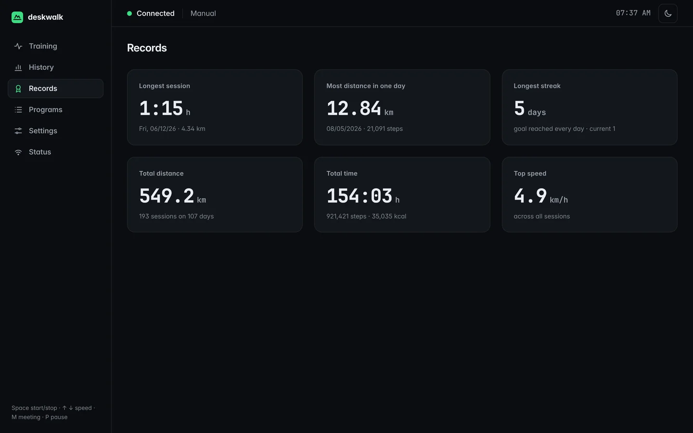 | 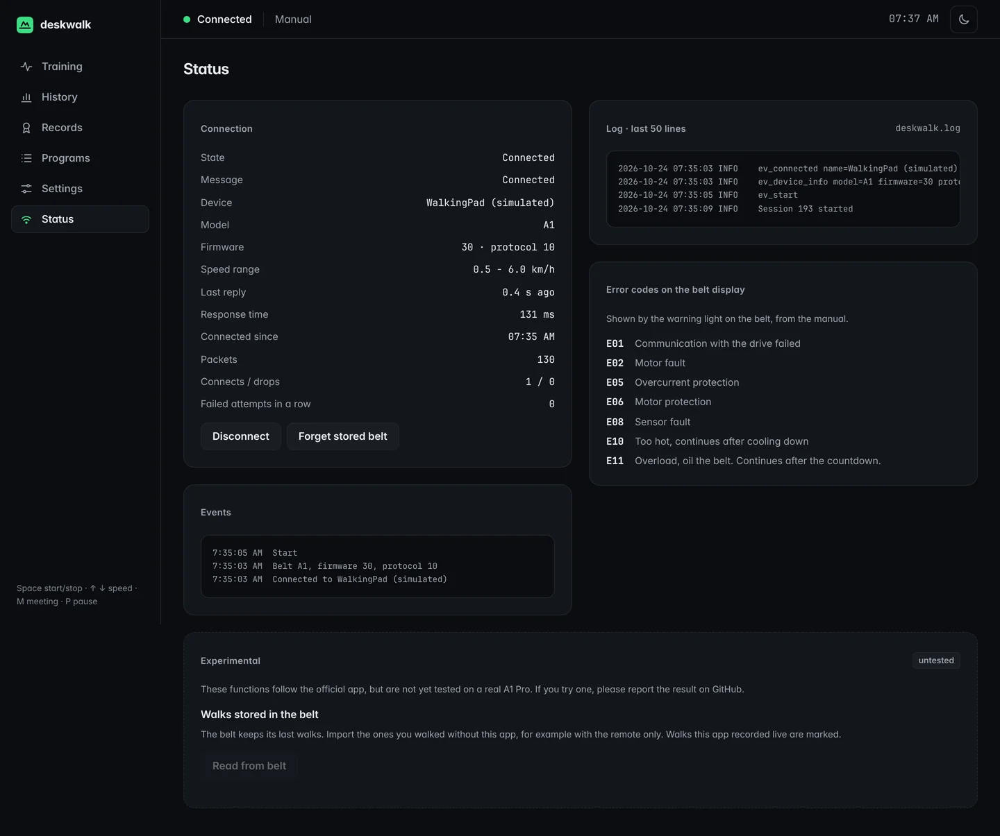 |
| Records | Status, stored walks, error codes |

<details>
<summary>More: phone, settings, programs, German</summary>

| | | |
|---|---|---|
| 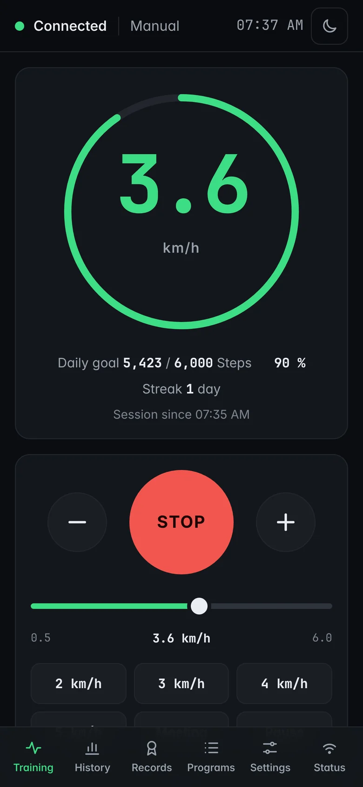 | 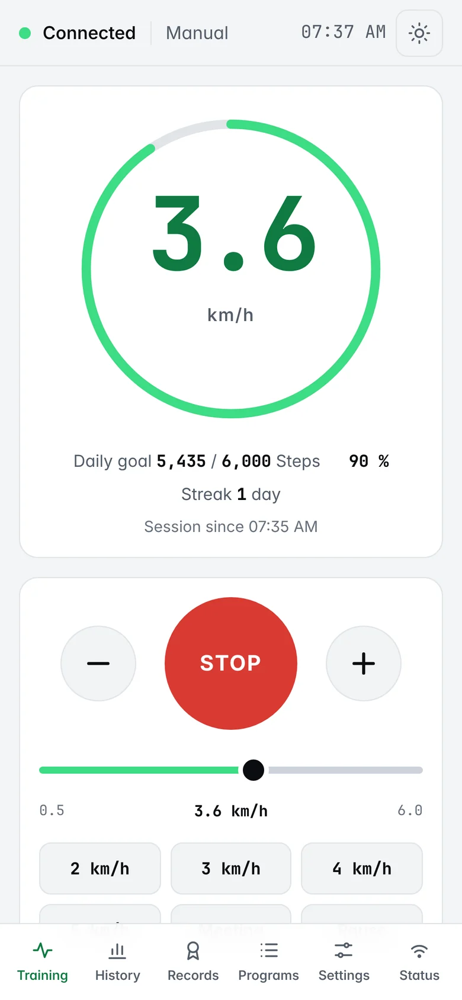 | 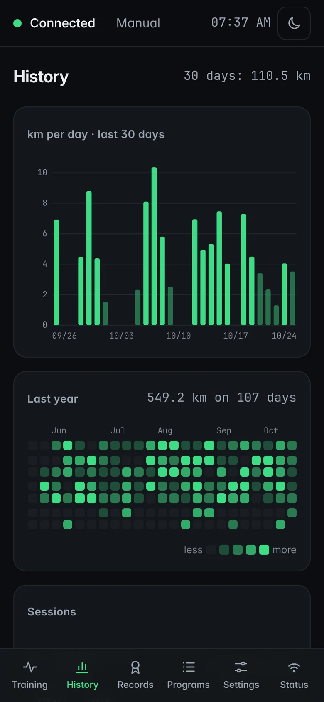 |

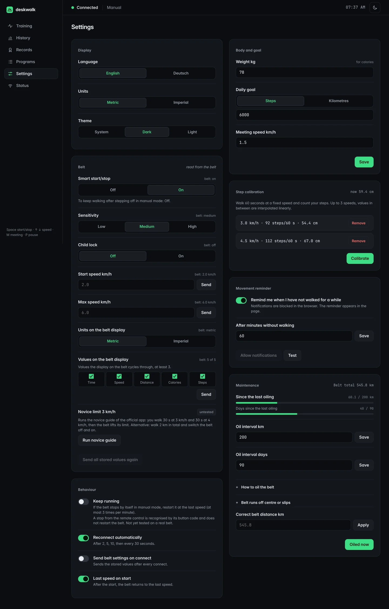
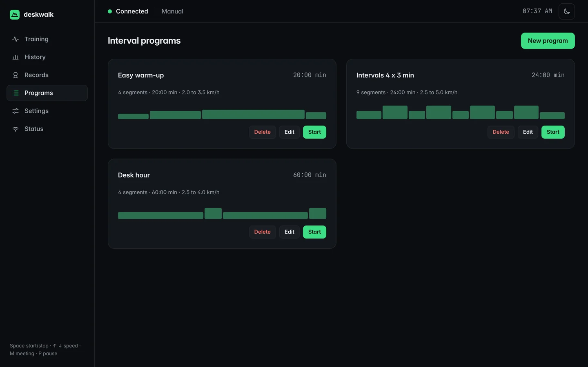
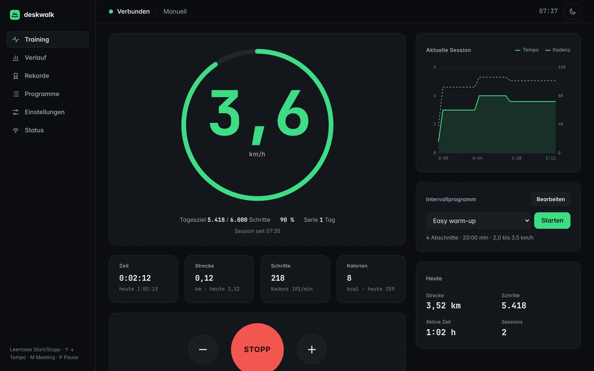

</details>

The screenshots show demo data from the built-in simulator.

## Requirements

- Python 3.10 or newer
- Bluetooth Low Energy on the computer that runs the server
- A Kingsmith WalkingPad with the classic Bluetooth protocol, see [supported models](#supported-models)

Tested on Linux. `bleak` also supports macOS and Windows, reports are welcome.

## Start

```bash
git clone https://github.com/DmE89/deskwalk.git
cd deskwalk
python3 -m venv .venv
.venv/bin/pip install -r requirements.txt
.venv/bin/python server.py
```

Open <http://127.0.0.1:5000>. On the phone use the Wi-Fi address that the server prints.

Switch the belt on and disconnect the official phone app first. The belt accepts only one Bluetooth
connection. deskwalk finds the belt by its name and remembers it for the next start.

Without a belt: `python3 server.py --sim` runs a simulated belt (no `bleak` needed).

| Option | Meaning |
|---|---|
| `--host 127.0.0.1` | only this computer, not the phone (default `0.0.0.0`) |
| `--port 5000` | port of the web page |
| `--data FILE` | data file (default `data.json` next to `server.py`) |
| `--address XX:XX:...` | Bluetooth address of the belt, skips the scan |
| `--sim` | simulated belt |

### Start automatically (Linux)

A systemd user service starts deskwalk when you log in. Adjust the path in
[`docs/deskwalk.service`](docs/deskwalk.service), then:

```bash
mkdir -p ~/.config/systemd/user
cp docs/deskwalk.service ~/.config/systemd/user/
systemctl --user daemon-reload
systemctl --user enable --now deskwalk
journalctl --user -u deskwalk -f      # log
```

### On the phone

Open the Wi-Fi address and add the page to the home screen (Safari: share, *Add to Home Screen*.
Chrome: menu, *Add to Home screen*). It opens without the browser bar. The server has to run on
the computer.

## Keep walking after stepping off

The reason this project exists. In *Settings*, *Belt*:

1. Set *Smart start/stop* to *Off*.
2. Walk in manual mode.

Some firmware stops the belt without load anyway (seen on an A1 Pro with firmware 32, protocol 0,
where smart start/stop was off). Two switches under *Behaviour* help:

- *Hold the speed* (experimental): as soon as the belt slows down by itself, deskwalk sends the
  walking speed again, before the belt stands still. No countdown, the belt dips for a moment.
- *Keep running*: if the belt stopped anyway, deskwalk restarts it at the last speed, at most
  3 times per minute. The belt counts down 3 s first.

A stop or minus from the remote control is recognised by the button code the belt reports and is
not undone.

Newer firmware (protocol version 20 and up, shown in the status view) has its own
*Stop when nobody walks* setting, deskwalk shows it in the belt settings then.

## Keys

| Key | Action |
|---|---|
| Space | start / stop |
| Up / Down | speed plus or minus 0.1 |
| M | meeting speed, press again for the previous speed |
| P | pause, press again to continue at the same speed |

The keys work when no input field or button has the focus.

## Supported models

| Model | Bluetooth name | Status |
|---|---|---|
| WalkingPad A1 Pro | `WalkingPad`, `KS-ST-A1P` | tested |
| WalkingPad A1, C1, P1, C2/S1 | `WalkingPad`, `KS-...` | same protocol in the official app, not tested |
| WalkingPad A1 Pro ERP and other FTMS models | `KS-HD-...`, `KS-AP-...` | not supported, deskwalk says so |
| Xiaomi and Wi-Fi variants | | not supported, they work through a cloud |

Please report your model in an [issue](https://github.com/DmE89/deskwalk/issues/new/choose).

## Troubleshooting

**WalkingPad not found.** Switch the belt on, close the official app on the phone or switch off
Bluetooth there, and keep the computer within a few metres. After a change of the belt use
*Status*, *Forget stored belt*.

**Bluetooth does not work on Linux.** BlueZ has to run: `systemctl status bluetooth`. In a container
or WSL there is usually no Bluetooth.

**The belt stays at 3 km/h.** New belts have a novice limit. deskwalk shows a hint with the novice
guide: walk 30 s at 3 km/h and 30 s at 4 km/h. Alternative: walk 2 km in total and switch the belt
off and on.

**The phone cannot open the page.** Phone and computer need the same Wi-Fi, and the firewall of the
computer has to allow the port (default 5000).

**Notifications do not show on the phone.** Browsers allow notifications only on `http://127.0.0.1`
or HTTPS. On the Wi-Fi address the reminder shows inside the page.

**Something else.** *Status* shows the connection, the events and the last 50 log lines. The full log
is in `deskwalk.log`. Please attach the relevant lines to an issue.

## Data and privacy

Everything stays on your computer: settings and sessions in `data.json`, log lines in `deskwalk.log`.
Both are git-ignored. deskwalk makes no requests to the internet and loads no external fonts or scripts.
The Bluetooth address of the belt is stored in `data.json` and never sent to the browser.

A session starts when the belt starts moving and ends after 2 minutes of standstill. If the Bluetooth
connection drops, the session continues after reconnecting. An unreadable `data.json` is kept as
`data.json.broken-<time>` and the app starts empty.

## Security

Anyone in your network can control the belt while the server listens on `0.0.0.0`. Use
`--host 127.0.0.1` if you do not want that. Other websites cannot send commands: the server accepts
only same-origin JSON requests, checks the `Host` header against DNS rebinding and sends a strict
Content Security Policy. See [SECURITY.md](SECURITY.md).

## Safety

A treadmill is a machine with moving parts. Use deskwalk at your own risk. Keep children and pets away,
stop the belt with the remote control or the stop button when in doubt, and never stand on the belt
during the calibration run. *Keep running* restarts the belt automatically, switch it on only when you
want that.

## Development

```bash
python3 -m unittest discover -s tests     # no hardware needed
python3 server.py --sim                   # UI work with a simulated belt
```

```
server.py            entry point
deskwalk/            Python package
  protocol.py        Bluetooth frames, see PROTOCOL.md
  links.py           bleak link and simulated belt
  worker.py          Bluetooth thread, command queue, reconnect, novice guide
  sessions.py        sessions, goal, streaks, records, imports
  store.py           data.json
  settings.py        validation of settings from the UI
  web.py             HTTP server, security headers, static files
  fitness.py, logs.py
web/                 browser UI, ES modules, local fonts and icons
tests/
docs/                screenshots, systemd service
```

The Bluetooth protocol is described in [PROTOCOL.md](PROTOCOL.md). Contributions are welcome, see
[CONTRIBUTING.md](CONTRIBUTING.md).

## Credits

- [ph4-walkingpad](https://github.com/ph4r05/ph4-walkingpad) by Dusan Klinec (MIT) for the basic frames.
- Device info, settings, stored walks and the novice guide follow a static analysis of the official
  KS Fit app.
- Fonts: [Inter](https://rsms.me/inter/) and [JetBrains Mono](https://www.jetbrains.com/lp/mono/),
  SIL Open Font License, see `web/assets/fonts/`.

## Licence

MIT, see [LICENSE](LICENSE).
